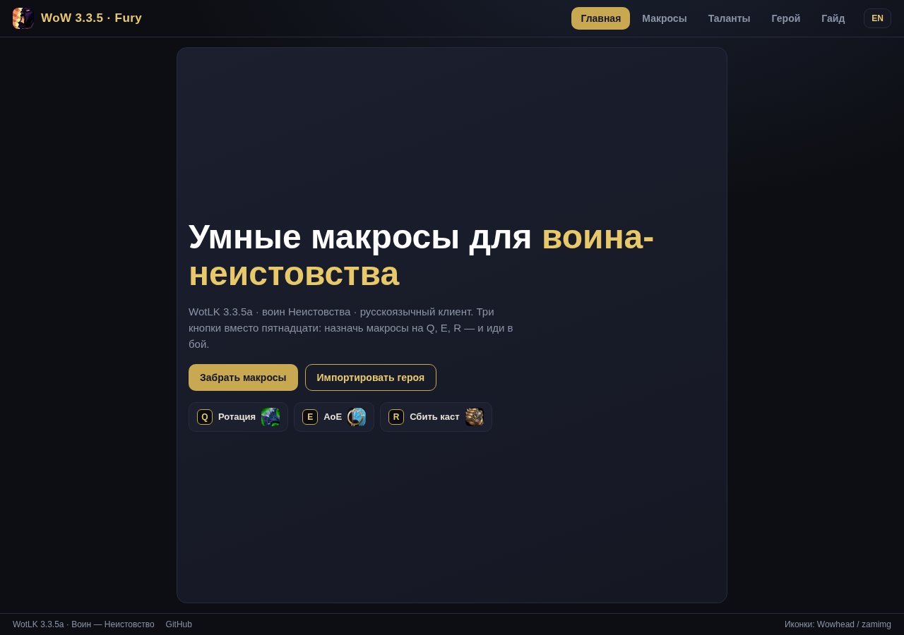
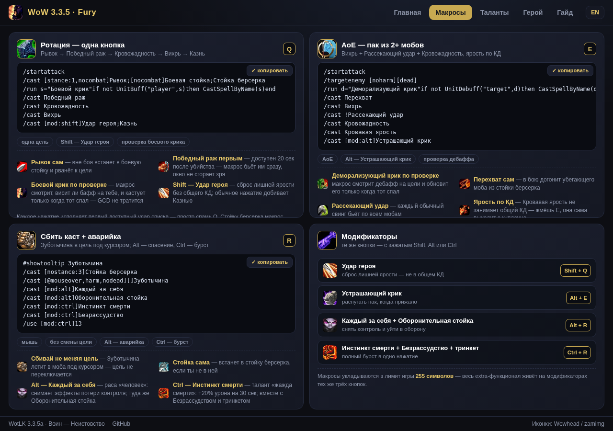
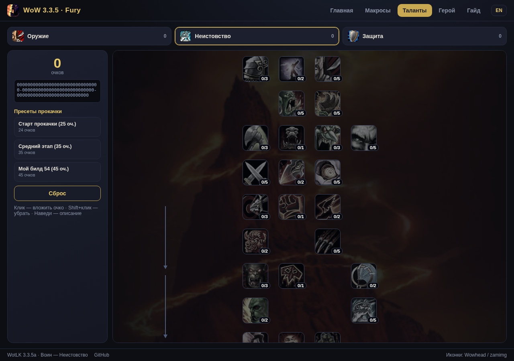
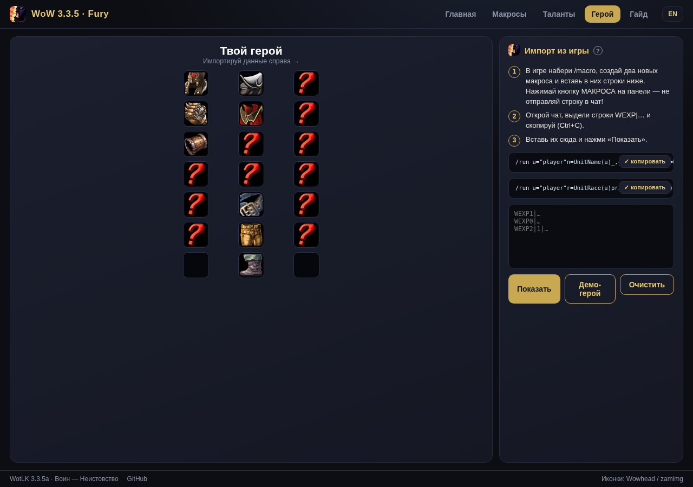

<div align="center">

# WoW 3.3.5a · Fury Warrior

**Three combat keys, a separate pre-pull buff checker, and talent builds from leveling to 80.**

[🌐 Game-style site](https://genocide12.github.io/wow-335-macros-v2/?lang=en) · [⬇️ RU/EN installers](https://github.com/Genocide12/wow-335-macros-v2/releases/latest) · [📋 Macros](https://genocide12.github.io/wow-335-macros-v2/macros.html?lang=en) · [🐛 Issues](https://github.com/Genocide12/wow-335-macros-v2/issues)

[](https://genocide12.github.io/wow-335-macros-v2/)
[](https://github.com/Genocide12/wow-335-macros-v2/releases)
[](README.md)
[](LICENSE)

</div>

## Quick start

1. Download the [RU installer](https://github.com/Genocide12/wow-335-macros-v2/releases/latest/download/macros-cache-ru.txt) or [EN installer](https://github.com/Genocide12/wow-335-macros-v2/releases/latest/download/macros-cache-en.txt).
2. Close the game and back up your existing `macros-cache.txt`.
3. Copy the selected file into the account folder under `WTF`, named `macros-cache.txt`.
4. Start the game, open `/macro`, bind the combat macros to `1`, `2`, `3`.
5. The buff-check helper is a separate optional fourth macro: copy it from the [macro page](https://genocide12.github.io/wow-335-macros-v2/macros.html?lang=en) and bind another key. Aura checks run out of combat only.

## Combat macros

| Key | Role |
|---|---|
| `1` | Fury single-target priority, Charge out of combat, cooldowns in combat |
| `2` | AoE and target pickup; before combat tries Battle Shout if missing |
| `3` | Pummel mouseover/current target, Berserker Rage and emergency actions; `Alt` for optional actions |
| `4` (separate macro) | Checks Battle Shout and Demoralizing Shout before pull; `Ctrl` manually casts Demoralizing Shout |

Line order is priority. Each macro runs only on a key press; normally just one GCD ability fires per press. It is not a bot and will not decide when you need a defensive cooldown.

## Talent builds to level 80

Open the [interactive talent viewer](https://genocide12.github.io/wow-335-macros-v2/talents.html?lang=en). Adapted leveling paths for Fury, Arms and Protection are included, plus separate **Fury PvE raid 18/53/0** and **Fury solo DPS/survival** presets. The raid preset targets WotLK 3.3.5a Titan’s Grip PvE; it is not a universal best build for every server or gear set.

## Hero and random demo

The [Hero page](https://genocide12.github.io/wow-335-macros-v2/hero.html?lang=en) accepts WEXP export data from a 3.3.5a client or generates a randomized demo character. The demo selects a level/spec-appropriate talent preset and randomizes name, race and gear. It is a UI preview, not a real character import.

## 3.3.5a macro limitation

Built-in macro conditionals cannot inspect buff/debuff presence. The `UnitBuff` + `CastSpellByName` Lua checker is an optional separate macro used only out of combat; `UnitDebuff` here is only used out of combat after a deliberate button press. Protected Lua casts are blocked in combat. Verify spell names and behavior on your server; private-server rules may differ.

## Build and validate

```sh
python scripts/build.py
python scripts/validate.py
python scripts/check_talents.py
```

Installers and the website macro catalog are generated from `macros/warrior-smart/{ru,en}/`. CI checks macro commands, the character limit, source/output synchronization and talent preset legality.

## Screenshots






## License

MIT. Not affiliated with Blizzard Entertainment.
