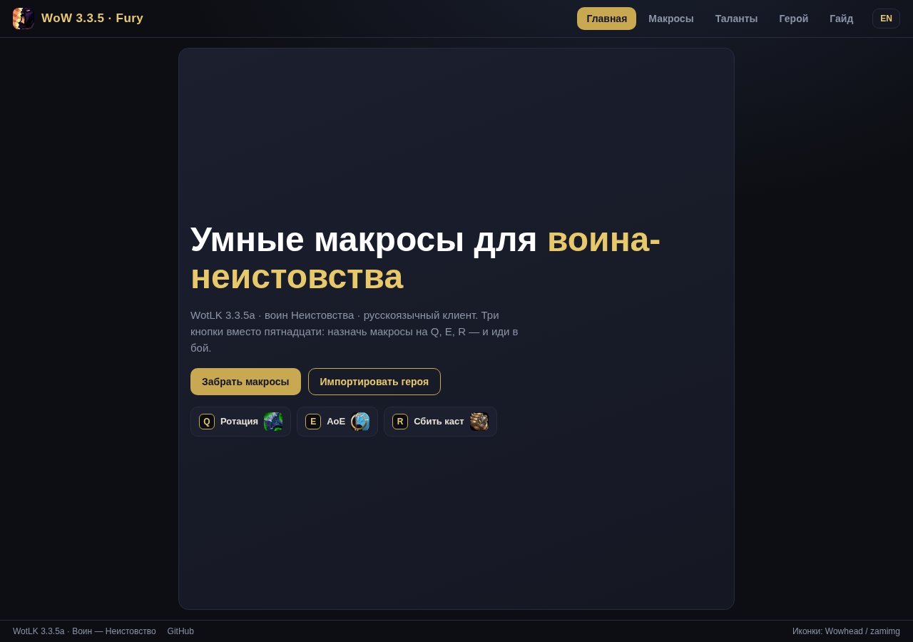
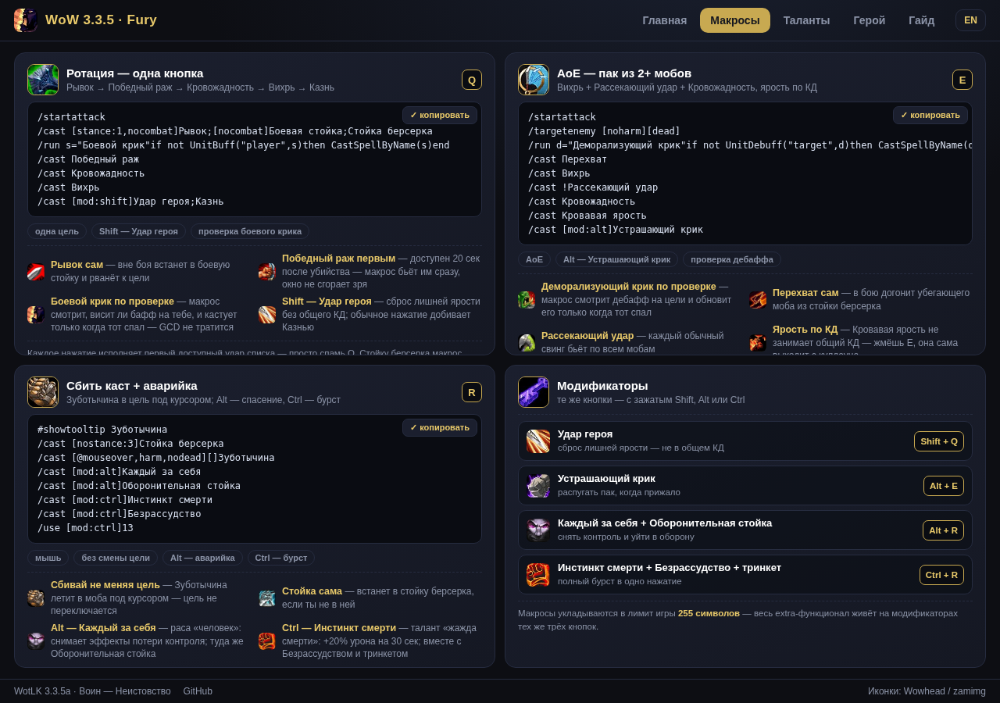
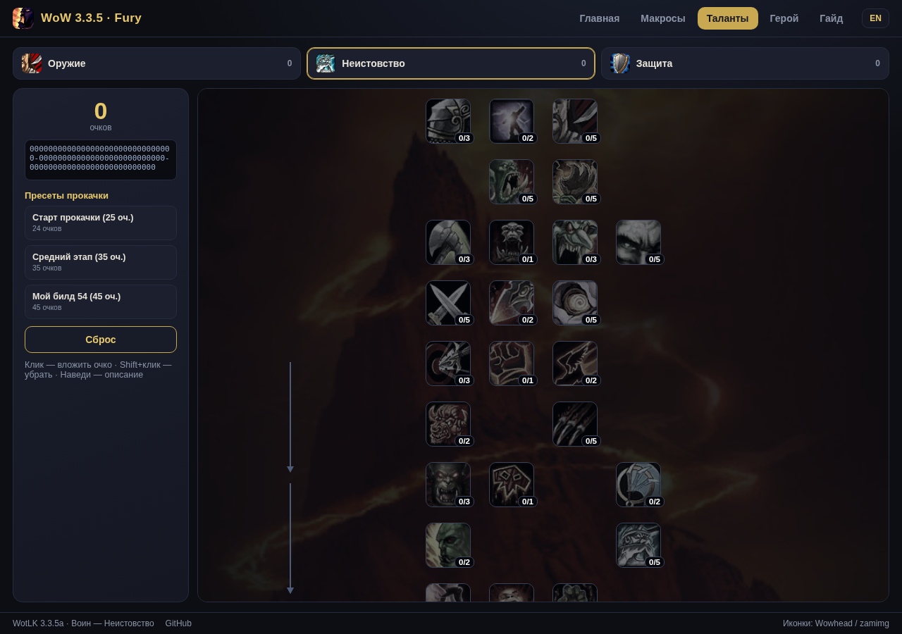
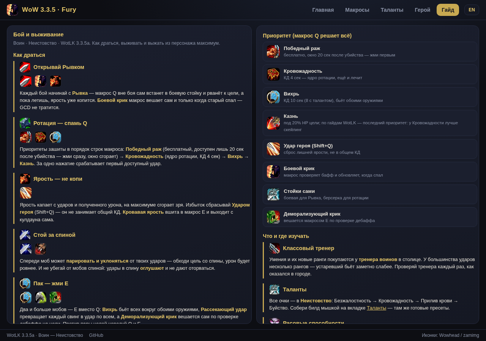
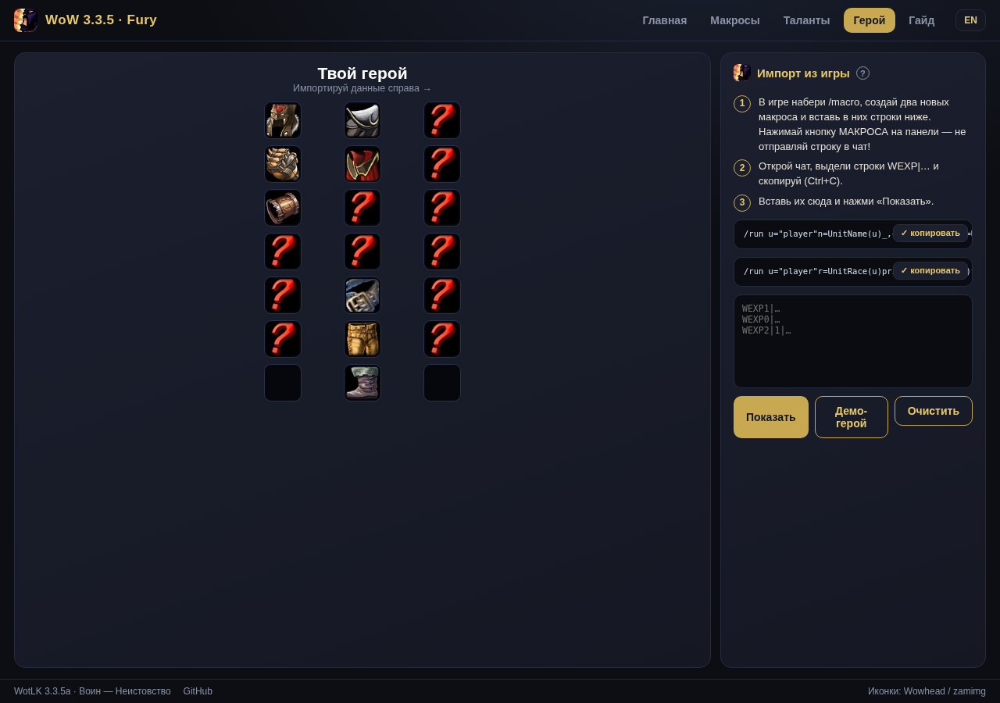

<div align="center">

# WoW 3.3.5a · Fury Warrior

**Три простых макроса на обычные клавиши: одна цель, AoE, прерывание и защита.**

Русский и английский клиенты · установочные файлы · гайд и просмотрщик талантов.

[🌐 Открыть сайт](https://genocide12.github.io/wow-335-macros-v2/) · [⬇️ Последний релиз](https://github.com/Genocide12/wow-335-macros-v2/releases/latest) · [📦 Все релизы](https://github.com/Genocide12/wow-335-macros-v2/releases) · [🐛 Сообщить об ошибке](https://github.com/Genocide12/wow-335-macros-v2/issues)

[](https://genocide12.github.io/wow-335-macros-v2/)
[](https://github.com/Genocide12/wow-335-macros-v2/releases)
[](README.en.md)
[](LICENSE)

</div>

---

## Быстрый старт

1. Скачай установочный файл для локализации клиента: **[русский](https://github.com/Genocide12/wow-335-macros-v2/releases/latest/download/macros-cache-ru.txt)** · **[English](https://github.com/Genocide12/wow-335-macros-v2/releases/latest/download/macros-cache-en.txt)**.
2. Закрой игру. Сделай копию старого `macros-cache.txt`.
3. Сохрани выбранный файл в папке аккаунта внутри `WTF` под именем `macros-cache.txt`.
4. Запусти игру, открой `/macro`, назначь три боевых макроса на `1`, `2`, `3`.

Нет релиза? Открой [список релизов](https://github.com/Genocide12/wow-335-macros-v2/releases) или [каталог макросов на сайте](https://genocide12.github.io/wow-335-macros-v2/macros.html).

## Что внутри

| Клавиша | Для чего |
|---|---|
| `1` | Одна цель и основной приоритет Fury |
| `2` | AoE: выбор цели, автоатака и атаки по группе |
| `3` | Прерывание по наведению и доступные защитные/контрольные умения |

Одинаковые версии доступны на русском и английском языках. Умения с уровневым или талантным требованием можно добавить в макрос, но клиент применит их лишь когда персонаж уже знает способность и соблюдены игровые условия.

## Важно знать о макросах WoW

WoW 3.3.5a проверяет макрос только при нажатии кнопки: он не следит за боем самостоятельно и обычно применяет лишь одно действие с GCD за нажатие. Штатные условия не позволяют макросу проверить наличие баффа/дебаффа, процент здоровья цели или решить, когда использовать бурст. Поэтому это приоритетные кнопки, а не бот. Включай защитные и долгие усиления вручную, когда считаешь нужным. Не запускай защищённые действия через Lua-автокаст.

## About

**WoW 3.3.5a: RU/EN макросы Fury-воина с установщиками, гайдом и GitHub Pages.**

## Сайт и материалы

[Открыть проект](https://genocide12.github.io/wow-335-macros-v2/) · [Макросы](https://genocide12.github.io/wow-335-macros-v2/macros.html) · [Таланты](https://genocide12.github.io/wow-335-macros-v2/talents.html) · [Гайд](https://genocide12.github.io/wow-335-macros-v2/guide.html) · [Импорт персонажа](https://genocide12.github.io/wow-335-macros-v2/hero.html)











## Сборка и проверки

Исходники находятся в `macros/warrior-smart/{ru,en}/`. Установщики и тексты макросов для сайта генерируются из исходников:

```sh
python scripts/build.py
python scripts/validate.py
```

GitHub Actions проверяет команды, синхронизацию установщиков и сайта, локализацию «Жажда смерти», отсутствие клавиш-модификаторов в боевых макросах и ограничение клиента в 255 символов. Реальную работу всё равно нужно проверить на манекене: приватные серверы могут менять умения и условия.

## Релизы

Релизы публикуются вручную по готовности. В каждом релизе прикладываются `macros-cache-ru.txt` и `macros-cache-en.txt`. Страница и README обновляются через GitHub Pages после публикации изменений в `main`.

## Лицензия

MIT. Проект не связан с Blizzard Entertainment; игровые названия и материалы принадлежат соответствующим владельцам.
